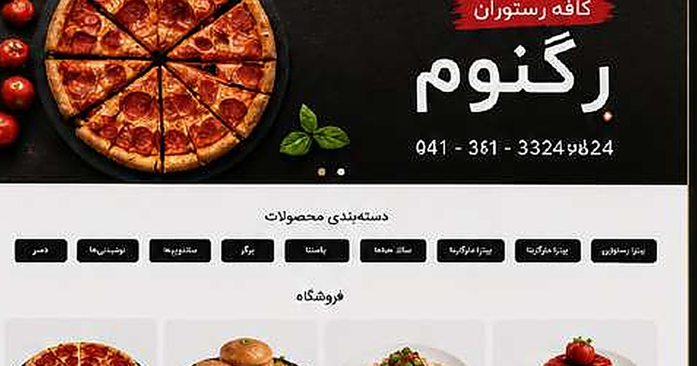

# Regnum Cafe

**Online Ordering Website · Client Project Portfolio Case Study**

## Overview

Cafe and restaurant website focused on menu presentation and online ordering with a simple responsive interface and fast access to product categories.

## My Contribution

- Restaurant website implementation
- Digital menu structure
- Online ordering experience
- Responsive optimization

## Technologies / Focus

- WordPress
- WooCommerce
- Digital Menu
- Online Ordering
- Responsive Design

## Source Code

The production source code is **not published** in this repository. This is a client-owned project, and this repository is intentionally limited to a portfolio case study and archived visual material.

## Portfolio Note

The screenshot above is an archived project preview from my portfolio records. A client's live website may have changed after delivery, so the current production site should not automatically be treated as an exact representation of the version shown here.

## Rights & Attribution

Client names, trademarks, logos, product photography, and other third-party visual assets remain the property of their respective owners. This repository documents my professional contribution and does not redistribute the underlying client codebase.
